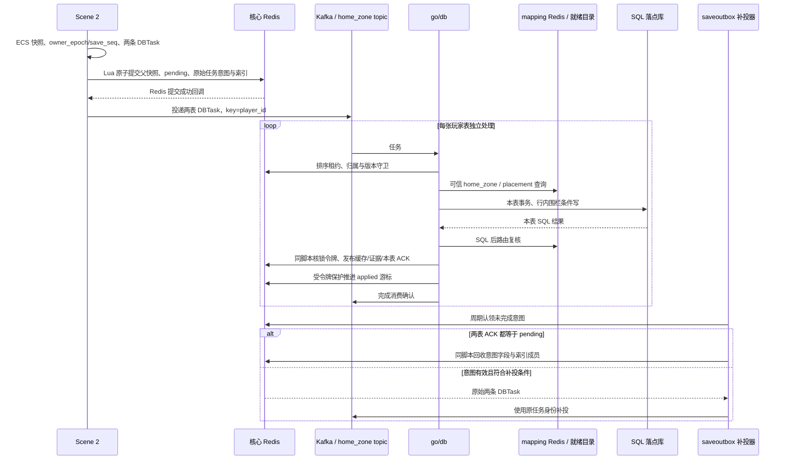

# 交接：Redis 物理水平扩展需求与当前存盘链问题（2026-10-22）

> 接手对象：Claude Code。本文记录用户目标、当前源码事实、必须保持的保证和待解决问题，具体方案由接手者自主分析决定。
>
> 本次范围：只整理文档，未修改代码、协议、配置或运行环境，未启动实现、构建、测试、压测或部署。
>
> 核对基线：2026-10-22，主仓 HEAD `190d9f2ea8` 加当时未提交的工作区；尤其包含其他任务的 `DBTask.op → DBOp` 联动。以下描述是源码与检出配置核对，不代表当前运行进程或真实基础设施已通过验收。

## 1. 用户需求与接手任务

用户原话：**“我就想 redis 可以物理水平无限扩展”**，并明确要求**“具体方案让它自己定，先别改代码”**。本次交付因此仅为这份交接文档，供后续会话接手。

工程目标是：随着业务增长，能够持续增加物理存储节点，扩展实际可用容量和读写吞吐；避免所有 zone 最终仍受同一个 Redis 主节点、全局热键、单一接入进程或不可控连接数量约束。需要说明真实扩展边界与下一阶段扩容方式，不能把“无限”当作任何有限部署都没有容量上限的承诺。

- 规模背景：用户提出未来可能有 **10 万个逻辑 zone**。zone 数不等于在线玩家数、Redis 节点数或验收吞吐；并发玩家数、快照大小、存盘频率、积压窗口、延迟目标和可接受扩容停写时间尚未定标。
- 支持跨 zone 游玩，保留位置透明：玩家在目标 Scene 中的业务处理不应散落“本区玩家 / 跨区玩家”分支。不要为简化存储擅自限制现有跨区能力或改成另一种转区体验。
- 扩容必须增加真实承载能力。只增加副本、代理、服务副本或连接数，不能单独作为写吞吐与容量已经扩展的证据。
- 连接拓扑也是需求的一部分。用户特别担心大量 Scene 与大量 Redis 节点形成多对多直连；方案须量化连接、连接池、带宽、排队和故障影响范围。
- 分片粒度、寻址、接入方式、是否使用 Redis Cluster、是否拆为多个部署单元、是否调整存盘职责及协议，均由 Claude Code 根据源码与证据评估。聊天中出现的“一 zone 一分片”“按玩家分片”“统一数据接入”“独立 Redis 分片”都是讨论材料，**不是本次已选定方案**。

接手时先完成根 `AGENTS.md` 的启动门禁，保留最新工作区；本文件不替代当时的用户指令。后续设计与落码应明确哪些既有设计继续适用、哪些结论被修订，以及原因。

## 2. 当前数据归属与职责

| 概念 / 节点 | 当前职责与需要避免的误解 |
|---|---|
| 当前 zone | 玩家正在运行的场景区；跨区后由目标 Scene 承载运行时 ECS |
| home_zone | 逻辑归属；Scene 当前据此选择 DBTask topic 和补投索引的 zone 部分，不据此动态选择 Redis 地址 |
| SQL placement | 玩家主数据的物理落点；由 go/db 消费时按可信目录选库，不等于玩家当前 zone，也不等于核心 Redis 的物理分片 |
| 核心 Redis | Scene 父快照、归属围栏、存盘屏障和补投意图等的当前原子存储域；当前链依赖共享的同一实例 |
| Kafka | 持久传送 DBTask；Scene 构造任务，成功提交 Redis 后投递，Redis 不会自动把快照“放回 Kafka” |
| go/db | 消费任务、校验归属及顺序、解析落点、写 SQL、复核目录、发布缓存与提交证据 / ACK、推进消费 |
| data_service | 维护目录与相关数据能力；当前 Scene 普通快照存盘不经它转发，go/db 的普通任务也不是逐条 RPC 调它解释 home_zone |
| SceneManager / player_locator | 分别涉及场景归属、位置交接与 Gate/session 状态；它们也是核心状态的读写方，改变分片时不能遗漏 |

玩家属于 zone 1、正在 zone 2 游玩时，**当前代码仍写同一套共享核心 Redis**，并按 home_zone 选择 `db_task_zone_1`（topic 世代按配置附加）。这不是已经实现了“Scene 2 自动回连 zone 1 专属 Redis”。相关句柄固定装配在 `RedisSystem::Initialize`。

### 2.1 本次核对的配置口径

| 配置 | 当前检出值 | 含义 |
|---|---|---|
| data_service `RouteStore.Mode` | `db_first` | 路由目录以全局 SQL 为权威，Redis 是发布与就绪读的一部分 |
| data_service `ReadRequiresReady` / `Reconcile.ArmReadyMarker` | `true` / `true` | 读方就绪与目录对账按当前配置开启 |
| go/db `Placement.Required` | `true` | 缺少有效 placement 不能作为正常成功路径回落本区库 |
| go/db `Placement.RequireRouteReady` | `true` | 当前默认经就绪读脚本取路由，不应描述为无条件直接 MGET |
| go/db `Fencing.Mode` | `dual` | 两表行内版本围栏、SQL ACK、补投协议启用 |

这些是仓库配置，不是运行环境证明；data_service 代码的零配置缺省仍可能是 `redis`，不要把零配置缺省与随仓 YAML 混为一谈。旧文档与聊天中“默认 redis / 不要求 ready / 缺 placement 回落”的口径不能直接用于本次设计。

## 3. 当前严格存盘链

以下以 home_zone=1、当前在 zone 2 的玩家为例。完整跨区节点图与登录时序已有记录，见 [跨 zone 场景传送 §15](../design/cross-zone-scene-travel.md#15-跨-zone-完整节点与数据流程2026-10-20源码核对)；该节核对时间较早，配置与近期接口变化以本文件和最新源码为准。



### 3.1 关键提交与恢复语义

1. `SavePlayerToRedisImpl` 先完成两表任务序列化，再调用 `SaveWithCommitBarrier`。任意一表序列化失败，不应提交父快照。
2. Lua 在核对 owner 等条件后，原子处理父快照、`pending`、两条完整原始任务意图及待补投索引。Redis 成功回调中的提交钩子才投 Kafka；进程在两者之间退出，由持久意图补投。
3. 两张表各自执行 SQL 事务，并不是一个跨双表事务。go/db 在 SQL 后复核路由，再通过令牌脚本发布缓存、资产 SQL 提交证据及对应表 ACK。
4. Kafka broker ACK、Redis 命令成功、单表 SQL 提交、两表 SQL 同版提交是不同事实，不能互相替代。当前双表屏障的放行判断不额外等待 applied 游标。
5. 补投器只在两表 ACK 精确等于 pending 时回收对应意图与索引；broker 确认不会删除唯一恢复意图。当前补投有退避、在途推迟、次数上限与终态保留，不是无限重投。
6. 源 Scene 跨区交接先冻结并保存；`BeginTravelHandoff` 的 Lua 要求旧 owner 有效，且两表 ACK 都等于本次 pending，才发布 handoff。目标登录冷恢复也受提交屏障约束，不能绕过屏障用旧缓存恢复。
7. Redis 原子性不等于 Redis 与 Kafka / SQL 的跨系统事务，也不等于命令应答已经覆盖任意故障模型下的持久性；部署的 AOF、复制和确认边界需要单独说明。

## 4. 已确认的扩展问题

### 4.1 C++ 存盘四键未同槽

玩家 `42`、home_zone `1` 的实际键形示例：

```text
PlayerAllData:42
player:42:owner_epoch
player:{42}:save_barrier
player:save_pending:1:42
```

当前只有屏障键带真正的玩家 hash tag。`kSaveWithCommitBarrierLuaScript` 与四键 EVAL 调用明确依赖同一 Redis 实例；换成 Cluster 地址无法保持现有原子范围。

Redis Cluster 的多键原子操作要求同槽，且槽是有限的；独立键可以分散，一个热点键不会随新增主节点自动拆开。增加副本主要提供可用性或部分读扩展，不能代替主分片写扩容。见 [Redis Cluster 官方规范](https://redis.io/docs/latest/operate/oss_and_stack/reference/cluster-spec/)。

### 4.2 补投索引跨多个玩家，不能只改玩家键名

当前索引为 `player:save_pending:<home_zone>:<player_id % 64>`，每个 home zone 固定 64 桶；意图内容在该玩家的 `save_barrier` hash 内。

即使父快照、owner 与屏障统一按玩家同槽，一个包含多个玩家的桶也不会自然与所有玩家同槽。C++ 原子登记、Go claim / 回收、扫描调度、协议世代、合服排空与恢复工具须一起设计。把索引移到原子步骤之外，就必须证明提交成功后仍能完整发现意图，不能留下进程退出即永远漏存的窗口。

### 4.3 go/db 的 SQL 后发布与游标也依赖多键原子操作

`playerCachePublishLua` 同时涉及排序锁、子表缓存、资产 SQL 提交证据与屏障 ACK；`appliedAdvanceLua` 同时涉及排序锁、游标和 applied epoch。锁键由 `RunTokenScript` 加入 KEYS，不能只检查调用处显式传入的业务键。

当前 saveoutbox 装配还显式拒绝 owner 与父缓存分实例。只改 Scene 写入、只搬缓存或只替换 Go 客户端，会使消费、确认、补投或恢复链断开。

### 4.4 客户端与连接拓扑尚未适配全链分片

- C++ 的 `MessageAsyncClient` 引用固定 Hiredis 连接；底层单地址 `redisAsyncConnect`，当前没有完整的 slot 路由和 `MOVED/ASK` 处理。已有单连接 FIFO、重连与回调顺序依赖也需要审计，不能默认分片后仍成立。
- go/db 的主 Redis、placement Redis 和 saveoutbox 专用池当前使用 `redis.NewClient`，不是整条链已支持 Cluster。
- data_service 的生产路由装配具备 ClusterClient 分支，DevRedis 则可提前返回同一单实例；局部存在 Cluster 客户端不能作为 Scene 存盘链已经支持 Cluster 的证据。
- 若多个 Scene 可容纳任意 home_zone 的玩家，按 zone 或玩家分片都会产生多目标访问。连接池可以复用，连接数不等于玩家数；是否直连、如何复用、如何限域由方案决定。
- 统一代理或存盘接入可以收敛 Scene 直连，但逻辑访问、网络流量和后端连接仍然存在，须证明新接入层不会成为集中瓶颈。

### 4.5 mapping 和归属状态不能遗漏

- 目录发布当前包含同连接 EVAL + WAITAOF；更换路由或连接池后，确认必须覆盖实际发生写入的节点与连接，不能随意在另一条连接上补发确认。
- mapping 的发布、就绪标记与实例身份核对仍有单实例前提。分片后要说明如何判断某条路由可信，以及缓存不可信时的处理方式。
- SceneManager 当前落点 Lua 已涉及 **owner、location、handoff、location revision、location revision floor 五把键**；不能沿用旧三键审计清单。
- player_locator 的会话 CAS 与租期 / Gate 索引，以及战斗结算、跨玩家索引等，也可能跨分片。需盘点全部创建、读取、更新、删除和恢复入口，不能把这份交接的示例清单当成穷举。

### 4.6 现有 data_service 字段接口不能直接承接严格快照存盘

`SavePlayerData` 当前契约是 `PlayerID + Data map + ExpectedVersion → NewVersion`，执行字段键的版本检查、锁与索引维护后返回。它没有承接这里的父快照、owner_epoch/save_seq、schema 门禁、两条 DBTask 补投意图和两表 SQL ACK 协议。

可以评估调整职责，但不能因为已有同名 Save RPC 就直接替换 Scene 调用并视为协议等价。是否新增或扩展存盘接口，由接手者设计。

### 4.7 扩容与运维闭环缺口

分片方案需覆盖拓扑变化、迁移中的旧写者、请求结果未知、失败重试、脚本缓存失效、故障切换、扫描与补投归属、合服及屏障重建。若选择 Cluster，还要核对跨槽 MGET / Lua / MULTI、逐主节点 SCAN、DB 0 限制等；若选择应用层分片，同样需要跨实例原子范围和迁移围栏。

上述是待解决的扩展约束，不是本轮已复现的线上性能事故。没有本轮基准测试，不能宣称已经达到瓶颈阈值，或某候选方案一定有多少倍提升。

## 5. 必须保留的可观察保证

可以重新划分职责或调整实现，但不能静默降低以下保证；采用不同协议时，应给出等价性与失败恢复说明。

1. **唯一有效写者**：同一玩家的权威归属唯一，旧 Scene、迟到请求、过期路由和迁移前写者不能覆盖新状态；数据处理节点的租约不能与 Scene 的 owner_epoch 混为同一种权限。
2. **可恢复提交**：已按约定受理的快照不能因 Scene 退出、Kafka 暂时不可用或切分存储而失去恢复路径；意图、发现索引与清理之间不存在无证明的缺口。
3. **幂等与版本**：重试与重复投递不重复生成资产或任务身份；owner_epoch/save_seq 与 schema 世代保护保持有效，uint64 版本比较不能退化为 Lua double 的有损比较。
4. **SQL 确认真实**：明确双表独立提交的中间态；跨区放行与冷恢复不能把 broker ACK、Redis ACK、单表成功或旧子缓存误当作本次双表提交。
5. **路由可信**：逻辑归属、SQL 落点、核心存储落点和运行位置分别定义；缺路由、畸形路由、未就绪、冻结、失租与读失败须有明确错误语义，资产完整性路径不能猜测本区并继续写。
6. **原子步骤安全**：提交点复核归属和令牌；Redis Lua 不会自动回滚脚本报错前已执行的写，参数与类型校验及失败顺序需要保留。
7. **完整生命周期**：加载、保存、离线、重连、跨区、扩容搬迁、缩容、合服、清理及恢复使用同一权威寻址契约，不产生新旧键或新旧路由各自成功的双持有者。
8. **资源有界**：异步调用、队列、连接、重试与恢复扫描都有可解释的上限与背压；C++ loop 不得被同步 I/O 阻塞，遵循 AGENTS.md 的连接 / 回调生命周期规则。

## 6. Claude Code 应自行回答的问题

以下是设计问题，不预填答案，也不要求照抄聊天中的候选结构。

- 存储分片以什么为稳定身份？业务 zone、运行位置与物理分片之间如何映射？同一热点 zone 能否继续拆分？
- 一次存盘的原子范围、成功应答、持久化确认与 SQL 完成分别是什么？由哪些节点负责？
- 添加物理节点时，哪些数据与流量会真正迁移过去？迁移前后如何阻止旧写者、处理在途任务、失败恢复及回退？
- Scene、Login、SceneManager、player_locator、go/db、data_service 和工具分别需要知道多少拓扑？每类进程的连接数如何随 zone 数、进程数与物理节点数增长？
- 补投意图如何分片、完整发现、认领和回收？SQL 两表只完成一表、新旧快照并发、broker 不可用时会发生什么？
- 全局索引、目录、选主、协议世代及恢复标记是否会成为新的单主 / 热键？哪些信息可重建，哪些是必须保护的权威状态？
- 所选方案下一次达到容量上限后，如何继续扩展？哪些上限来自单节点、单键、单集群、网络或其他基础设施？

历史材料里的指定路线需先核对：[共享 Redis 按用途拆分 §20–§25](../design/shared-redis-split-by-purpose.md) 记有“单元化 + 单元内按玩家 Cluster”的先前路线及未决项；[跨服架构原则](../design/cross_server_architecture_principle.md) 记有数据代理思路，但不代表当前 Scene 已按该链执行。**用户本次明确让 Claude 自定方案，历史候选不应被写成此次必须采用的实现。**位置透明、数据完整性等仍需保持；若选择替代路线，需同步解释对现行设计契约的影响。

## 7. 后续验收与交付要求

验收口径由选定方案细化，至少覆盖：

| 类别 | 应提供的证据 |
|---|---|
| 真实横向扩容 | 相同负载模型下，新增承载节点并迁移数据后，容量与读写分布确实改变；给出扩容前后吞吐、延迟、内存及瓶颈对比 |
| 连接规模 | 各类进程与存储节点的实际连接 / 池 / FD 预算，以及增长公式；若有接入层，测其队列、流量、延迟和副本故障 |
| 正常与跨区 | 本区与跨区加载、周期存盘、退出、重连、交接；扩容期间不读旧状态、不产生双写者 |
| 故障与恢复 | Redis 提交后 Scene 退出、Kafka 不可用及恢复、只有一表 SQL 成功、SQL 后 ACK 前退出、重复任务、失租、旧 owner 与旧路由写入 |
| 拓扑变化 | 新节点加入、迁移中断、重启及主节点切换；选择 Cluster 时再覆盖 MOVED / ASK / NOSCRIPT 与重分片，选择其他方案时给出对应等价场景 |
| 工具与索引 | 冷恢复、补投扫描、合服排空、屏障重建、清理与审计不会遗漏任何分片，失败不能静默算完成 |

先用真实业务参数建立容量模型；10 万 zone 只是规模背景，不能直接当作“10 万套 Redis”或“已通过 10 万 zone 验收”。压测按 `AGENTS.md §6` 执行，保留基线并使用规定的汇总输出。

按 `AGENTS.md §10.1`，Claude Code 负责修改代码、测试与文档，构建、测试和压测交给 Codex。交接需给出目标、工作目录、具体命令、环境变量名、前置条件、通过标准和失败时保留的摘要；未运行不能写“通过”。未来需要运行或清理环境时另按当时授权与规范执行，本文件未授权本轮清库或变更环境。

项目截至负责人 2026-10-18 确认为尚未上线，见 [存盘围栏设计文末“上线状态”](../design/db-write-fencing-mysql.md)。接手时核实是否变化；按上线前实际范围设计，不凭空承担不存在的线上混跑，同时保护现有开发数据与他人工作区。

Java 双版按 `AGENTS.md §12` 处理：本次只是本仓需求交接，没有两版功能落码或客户端契约变更，Java 当前实施状态需后续另核；其内部存储路径不应机械照抄 C++ / Go 的 DBTask 链。后续实现需交代两版影响与对齐状态。

## 8. 源码入口与阅读顺序

行号是本次核对的定位提示，工作区仍在变化，接手时按函数名再次搜索。

| 入口 | 本次定位 | 阅读目的 |
|---|---|---|
| [Scene Redis 装配](../../cpp/libs/services/scene/core/system/redis.cpp) | `RedisSystem::Initialize`，约 22 行 | 当前固定 Redis 句柄 |
| [Scene 生命周期](../../cpp/libs/services/scene/player/system/player_lifecycle.cpp) | `SavePlayerToRedisImpl` 4358；topic / 索引 4531；`publishDbTasks` 4576；屏障调用 4629；`BeginTravelHandoff` 5683 | 快照、原始任务、回调投 Kafka 与跨区交接 |
| [异步 Redis 存盘](../../cpp/libs/engine/infra/storage/redis_client/redis_client.h) | 四键脚本 83；`SaveWithCommitBarrier` 434；EVALSHA 870；`OnSaved` 1043 / 提交回调 1159 | 原子范围、在途合并与成功回调顺序 |
| [交接 SQL 屏障](../../cpp/libs/services/scene/player/system/handoff_sql_barrier.h) | `kPublishMarkLua` 30，双 ACK 比较约 66 | 旧 owner 与双表提交后放行 |
| [Kafka 投递](../../cpp/libs/services/scene/player/system/db_task_dispatch_system.cpp) | `SendDbTask` 125 / `sendTracked` 154 | 任务是谁构造和投递的 |
| [DB 消费](../../go/db/internal/kafka/key_ordered_consumer.go) | `handleTask` 2130；`processDBTask` 2802；`runDBOp` 2948 | 顺序、SQL、路由复核、证据与消费确认 |
| [DB 落点路由](../../go/db/internal/kafka/placement_route.go) | `lookup` 98；`routeTask` 284；`confirm` 255 | 可信目录读、冻结 / 缺失语义与 SQL 后复核 |
| [SQL 行内围栏](../../go/db/internal/kafka/player_row_fence.go) | `savePlayerRow` 101 / 本表事务约 145 | 版本条件写与重复投递 |
| [DB 发布脚本](../../go/db/internal/kafka/player_cache_publish.go) | `playerCachePublishLua` 26；`publishDBWriteResult` 75；`advanceApplied` 129 | 锁令牌、缓存、资产证据、屏障与游标 |
| [令牌锁脚本](../../go/db/internal/locker/locker.go) | `RunTokenScript` 133 | 自动加入锁键的原子范围 |
| [补投契约](../../go/db/internal/saveoutbox/contract.go)、[脚本](../../go/db/internal/saveoutbox/scripts.go)、[循环](../../go/db/internal/saveoutbox/replay.go)、[装配](../../go/db/internal/saveoutbox/service.go) | `pendingIndexKey`；`claimScript`；`Replay.Run/Tick`；`Start` | 64 桶、认领 / 回收、原任务补投和同实例门禁 |
| [登录父快照屏障](../../go/login/internal/logic/pkg/dataloader/parent_commit_barrier.go) | `parentBarrierKeys` 80；`beginParentLoad` 86 | 冷加载与重建父快照 |
| [SceneManager 落点](../../go/scene_manager/internal/logic/changesceneutil.go) | `placePlayerLocation` 177，五键 EVAL 205 | owner / location / handoff 与 revision 两键 |
| [会话 CAS](../../go/player_locator/internal/logic/session_cas.go) | 会话与相关索引脚本 | 不遗漏其他核心状态原子依赖 |
| [C++ 连接管理](../../cpp/libs/engine/thread_context/redis_manager.h)、[Hiredis](../../cpp/libs/engine/muduo_windows/src/contrib/hiredis/Hiredis.cc) | `GetZoneRedis` / `Connect`；`redisAsyncConnect` 74 | 固定端点、异步连接、重连与生命周期 |
| [data_service 字段存盘](../../go/data_service/internal/logic/data_logic.go)、[路由](../../go/data_service/internal/routing/router.go)、[目录发布](../../go/data_service/internal/routing/route_publish.go) | `SavePlayerData` 581；`ClientForPlayer` 517；`publishRoute` 约 244 | 区分字段接口、存档主链与同连接 WAITAOF |
| [DB 配置](../../go/db/etc/db.yaml)、[data_service 配置](../../go/data_service/etc/data_service.yaml)、[DB 装配](../../go/db/internal/svc/servicecontext.go) | `Fencing` / `Placement`；`RouteStore`；`redis.NewClient` | 本次配置与客户端事实 |
| [DBTask 源协议](../../proto/db/db_task.proto) | `DBOp` / `DBTask` | 工作区已改枚举；不要据旧字符串实现或手改生成物 |

补充设计入口：[存盘围栏](../design/db-write-fencing-mysql.md)、[存盘管线瓶颈](../design/db-task-pipeline-bottlenecks.md)、[玩家 SQL 落点](../design/player-storage-placement.md)、[data_service 职责](../design/data_service_role_and_scope.md)、[共享 Redis 拆分](../design/shared-redis-split-by-purpose.md)。它们用于补齐上下文，旧状态与默认值须和当前源码交叉核对。

## 9. 本轮完成与未验证范围

本轮仅新增此交接、登记文档索引并在 PROGRESS 追加记录；只做文档静态检查。没有实施任何分片方案，没有修改现有存盘代码或配置，没有启动 Claude Code，也没有运行存储拓扑、性能或故障验收。
